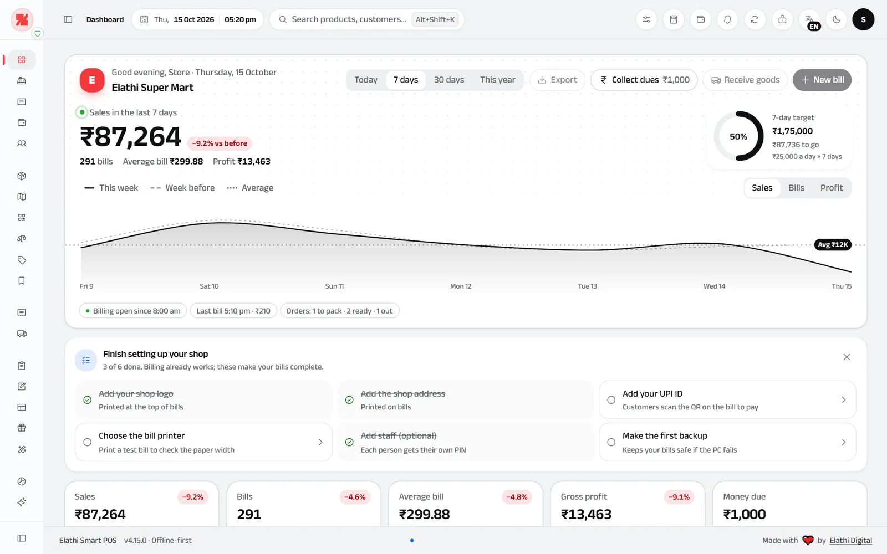
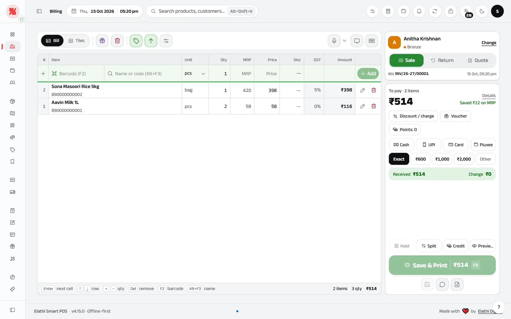
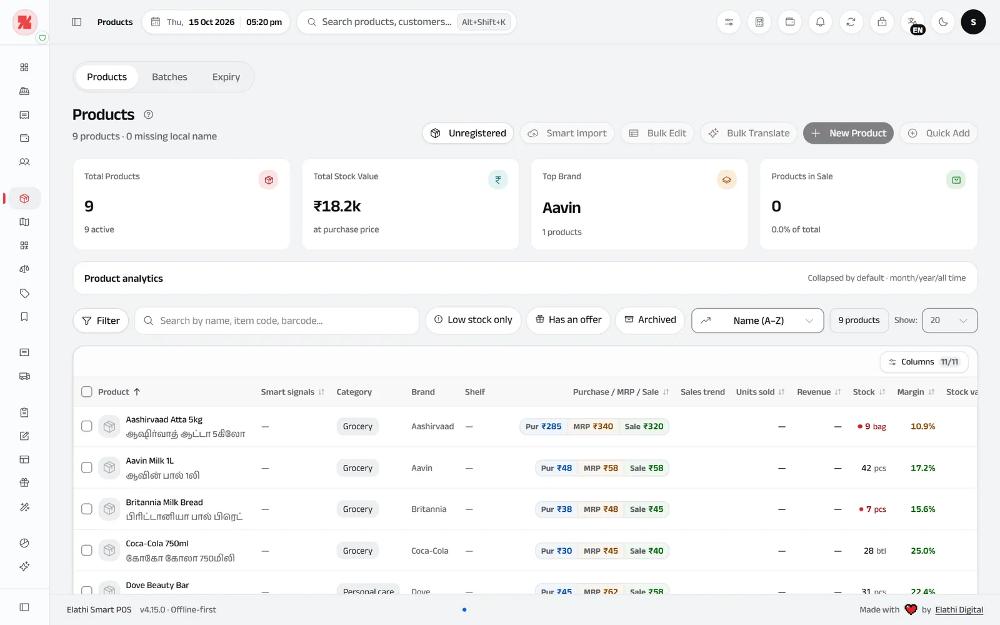
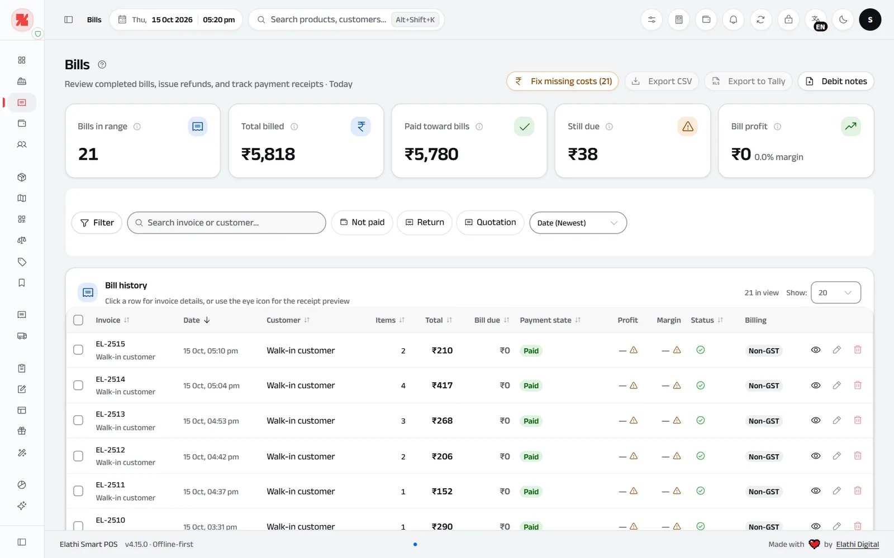
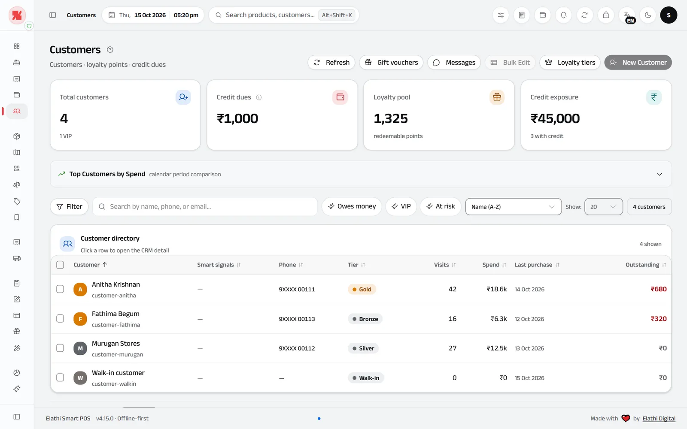
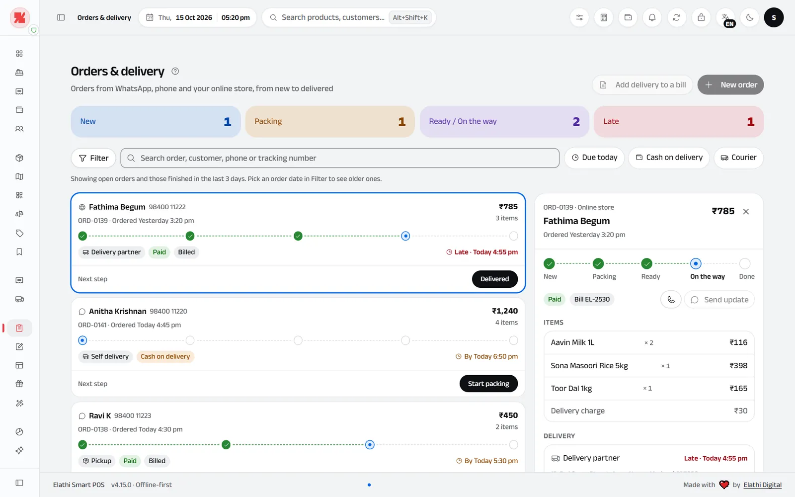
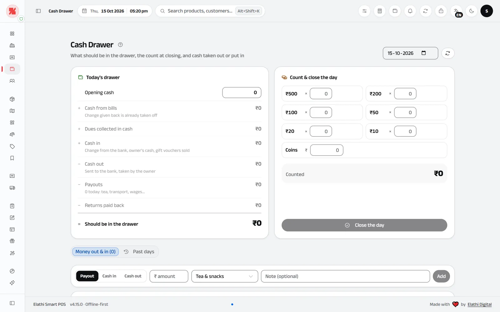
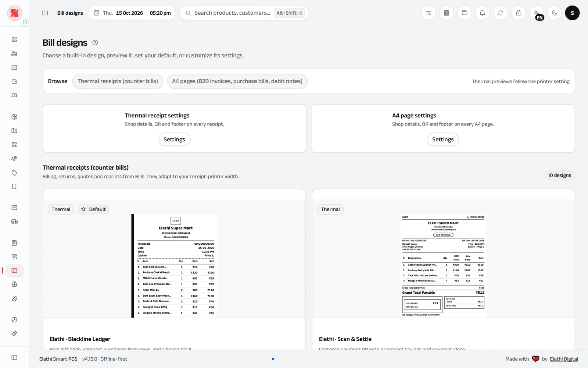

<!-- SMARTPOS_LANDING_START -->
# Elathi SmartPOS

## Billing and stock software for Indian shops, on your own PC

Elathi SmartPOS runs billing, GST bills, stock, purchases, customer credit, orders and reports on a Windows PC in your shop. It keeps working without internet, and extra counters connect to the main PC over your shop's Wi-Fi or LAN.

### [⬇ Download for Windows](https://github.com/Elathi/elathi-smartpos-releases/releases/latest/download/Elathi-SmartPOS-Setup.exe)

Latest version **v4.17.0** · Windows 10 or 11 (64-bit) · Free trial · [What's new](https://github.com/Elathi/elathi-smartpos-releases/releases/tag/v4.17.0) · [elathi.xyz](https://elathi.xyz/)

## What it does

- **Fast billing**: barcode or name search, pack sizes, discounts, returns, quotes, held bills, split payments, credit and loyalty points.
- **Bill by voice**: speak items in Tamil, Hindi, Telugu, Kannada, Malayalam or English, even without internet (optional voice pack), or use your phone as the microphone.
- **GST bills your way**: thermal receipts that fit your printer, A4 invoices for B2B, and ready-made designs you can preview and set as default.
- **Stock you can trust**: batches, expiry, MRP and sale price, stock counts, and archive that cleans up after the days you choose.
- **Purchases**: purchase bills with GST, supplier payments and advances, returns, and purchase orders you can print for the supplier's agent.
- **Customers and orders**: credit due with reminders, and WhatsApp, phone and online-store orders from new to delivered.
- **Reports and backups**: daily sales, profit and GST reports, the cash drawer, and backups you control.

## Screens

These screens use a sample store with made-up data.

| Dashboard | Billing |
| --- | --- |
|  |  |

| Products and stock | Bills |
| --- | --- |
|  |  |

| Credit due | Orders and delivery |
| --- | --- |
|  |  |

| Cash drawer | Bill designs |
| --- | --- |
|  |  |

## Installing for the first time

1. [Download the installer](https://github.com/Elathi/elathi-smartpos-releases/releases/latest/download/Elathi-SmartPOS-Setup.exe) on the shop's main billing PC. No administrator password is needed.
2. If your browser says the file **isn't commonly downloaded**, open the download's menu and choose **Keep** (in Edge: **Keep anyway**).
3. If a blue **Windows protected your PC** screen appears, click **More info**, then **Run anyway**.
4. If nothing seems to happen, look for the installer on the taskbar; it can open behind the browser.

These warnings appear because SmartPOS is new and its installer does not yet carry a paid publisher certificate. They do not mean anything is wrong with the file. Download SmartPOS only from this page or [elathi.xyz](https://elathi.xyz/).

**System requirements:** Windows 10 or 11, 64-bit. The offline voice pack also needs a processor with AVX2 (most PCs from 2015 onwards) and about 600 MB of free space.

## Updating

SmartPOS checks for updates by itself. Open **Settings → Updates**, or use the update button at the top, and install from there. The app checks every update is genuine before installing it, and your shop's data stays on the PC. When you have counters, update the main PC first, then each counter.

## Help

- **Product website:** [elathi.xyz](https://elathi.xyz/)
- **Contact and support:** [elathi.xyz/contact](https://elathi.xyz/contact/)
- **All versions:** [Releases](https://github.com/Elathi/elathi-smartpos-releases/releases)

<!-- SMARTPOS_LANDING_END -->

<!-- SMARTPOS_RELEASES_MANAGED_START -->
## Latest version

**v4.17.0** (page updated 2026-10-19 UTC)

- [Download the installer](https://github.com/Elathi/elathi-smartpos-releases/releases/latest/download/Elathi-SmartPOS-Setup.exe)
- [What's new in v4.17.0](https://github.com/Elathi/elathi-smartpos-releases/releases/tag/v4.17.0)
- Already installed? Update from **Settings → Updates** inside SmartPOS.

<!-- SMARTPOS_RELEASES_MANAGED_END -->
